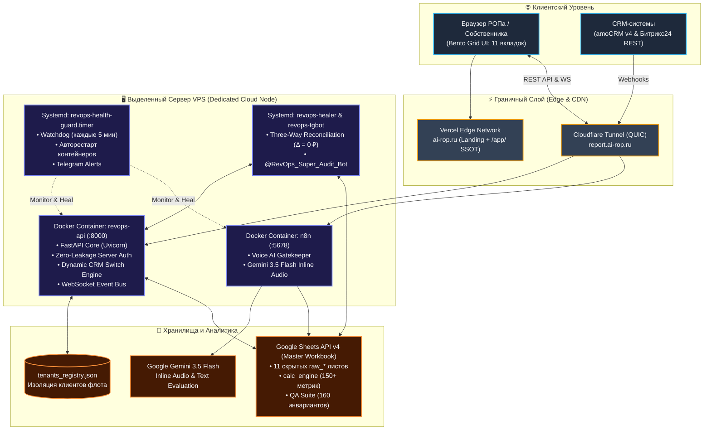

# 🏛️ Архитектура RevOps SaaS Platform (ai-rop.ru)

> **Версия системы:** RevOps SaaS V21.1 Production Edition  
> **Статус:** Боевой промышленный контур (`ai-rop.ru`, `report.ai-rop.ru`)  
> **Архитектурный паттерн:** Monorepo SSOT (Single Source of Truth), Docker Containerization, Zero-Leakage Security, Reactive Bento Grid UI, Dual-CRM Ingress  

---

## 1. Концепция и Архитектурный Стек

Платформа **RevOps SaaS** представляет собой облачное B2B-решение для речевого ИИ-аудита, чат-аналитики и сквозного контроля воронки продаж.



---

## 2. Структура Monorepo (SSOT)

Кодовая база консолидирована в единый монорепозиторий без дублирования:

```
revops-saas/
├── apps/
│   ├── api/                     # Ядро бэкенда на FastAPI
│   │   ├── main.py              # Точка входа, lifespan, CORS, middleware
│   │   ├── schemas.py           # Pydantic v2 модели и схемы данных
│   │   └── routers/             # Модульные эндпоинты
│   │       ├── auth.py          # Zero-Leakage серверная авторизация (PBKDF2/bcrypt)
│   │       ├── tenants.py       # Управление тенантами флота (Anti-IDOR)
│   │       ├── deals.py         # Работа со сделками и CRM-синхронизация
│   │       ├── calls.py         # Записи звонков, транскрипты, скоринг
│   │       ├── admin.py         # Панель администрирования и сброс CRM
│   │       └── health.py        # Диагностический эндпоинт /api/v1/health
│   ├── landing/                 # Продающий B2B промо-лендинг (ai-rop.ru)
│   │   ├── index.html           # 100% безналичный расчет (422-ФЗ / 152-ФЗ, без карт)
│   │   └── css/                 # Стили лендинга
│   └── web/                     # Единый личный кабинет РОПа / Собственника (ai-rop.ru/app/)
│       ├── index.html           # Bento Shell разметка (11 экранов)
│       ├── app.js               # Главный роутер и оркестратор состояний
│       └── js/                  # Модули бизнес-логики
│           ├── core.js          # Изоляция тенантов, сессии, темы (Light/Dark)
│           ├── calls.js         # Сегментированные пиллы звонков (Все/Эталон/Норма/Слив)
│           ├── deals.js         # Unified SSOT расчет финансов (calculateFinancials)
│           ├── charts.js        # KPI-спарклайны с 7-дневным трендом
│           └── admin.js         # Управление доступом и генерация паролей
├── deploy/                      # Докерфайлы и скрипты сборки
├── tests/                       # Pytest тестовый комплект (237+ тестов)
├── vercel.json                  # Конфигурация CDN и маршрутизации Vercel
└── .github/workflows/           # GitHub Actions (CI Gate + GHCR deploy)
```

---

## 3. Ключевые Подсистемы и Механизмы

### 3.1. Zero-Leakage Аутентификация и Защита от IDOR
* **Исключение клиентских секретов:** В коде браузера (`apps/web/`) отсутствуют захардкоженные пароли, мастер-ключи или хеши.
* **Серверная проверка:** Аутентификация выполняется исключительно на бэкенде через `POST /api/v1/auth/login` с проверкой хеша пароля через PBKDF2/bcrypt и генерацией сессионного токена.
* **Строгая изоляция тенантов (`getActiveTenantId()`):** Обычные пользователи и РОПы жестко заблокированы в рамках своего `sess.tenant`. Доступ к данным других клиентов пресекается (Anti-IDOR, возврат 403 Forbidden).

### 3.2. Реактивный Фронтенд (Bento Shell)
* **11 Рабочих экранов:** Операционный пульс, Аудит звонков, Воронка сделок, Диагностика утечек, Симулятор Монте-Карло, Мультиканальная атрибуция, Матрица навыков, Матрица окупаемости ИИ, Ресурсный план, Настройки, Админ-панель.
* **Сегментированные пиллы звонков:** Функция `updateCallsPills` в `calls.js` динамически пересчитывает количество звонков по категориям «Все», «Эталон», «Норма», «Слив» в реальном времени.
* **Живые KPI-спарклайны:** Модуль `charts.js` (`initSparklines`) вычисляет 7-дневные тренды через `getWeeklySeries(id)`.
* **SSOT Финансовый расчет:** Функция `calculateFinancials` в `deals.js` гарантирует абсолютную сходимость метрик Факт, Пайплайн и Взвешенный прогноз во всех виджетах.

### 3.3. Dynamic CRM Switch & State Reset
* При переключении источника данных (amoCRM $\leftrightarrow$ Битрикс24):
  1. Бэкенд обновляет параметр `crm_type` в `tenants_registry.json`.
  2. Лист `raw_deals` в Google Sheets физически очищается со 2-й строки и заполняется сделками целевой CRM.
  3. Оперативный in-memory кэш `_DEALS_CACHE` очищается (`_DEALS_CACHE.clear()`).
  4. По WebSocket клиентам отправляется событие `deals_updated`, вызывающее мгновенный пересчет витрин без перезагрузки страницы.

### 3.4. CI/CD и Продакшн-Контейнеризация
* **GitHub Actions:** При каждом пуше в ветку `main` выполняется тестовый шлюз (CI Gate).
* **GHCR:** Собирается образ `ghcr.io/reflecteddark/revops-saas:latest`.
* **VPS Deploy:** На целевом сервере VPS (`report.ai-rop.ru`) контейнер обновляется с нулевым временем простоя.
* **Self-Healing Guard:** Служба `revops_health_guard.py` на хосте контролирует контейнеры Docker и системные сервисы, автоматически перезапуская их при сбоях.
